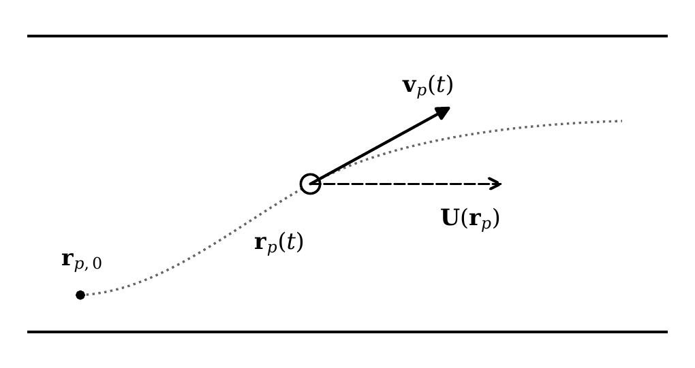
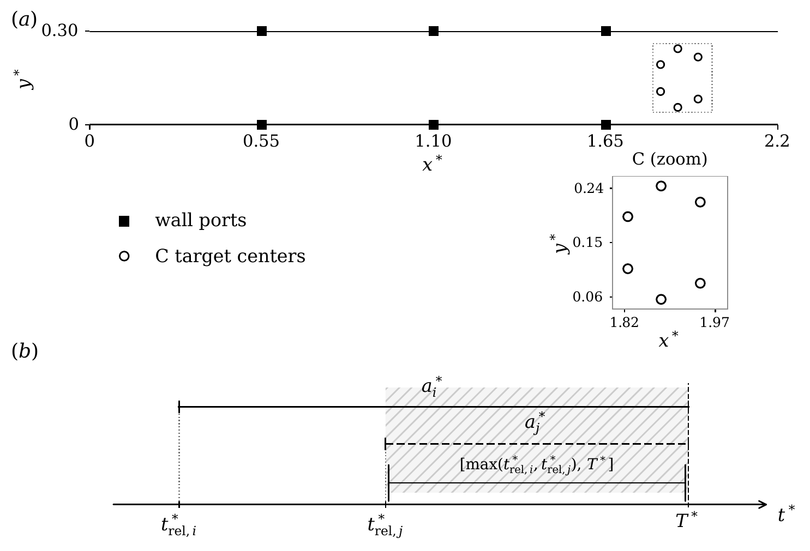

# Thesis Template

A LaTeX template for typesetting theses in Persian.

By: Hamid Zarrabi-Zadeh

## License
This work is licensed under a [Creative Commons Attribution 4.0 International License](https://creativecommons.org/licenses/by/4.0/).
## راهنمای استفاده

بخش‌های ۳٫۱ و ۳٫۲ در فصل «تئوری مسئله» تکمیل شده‌اند.
فایل این فصل `chapters/theory.tex` است.
سایر فصل‌ها و مشخصات فردی همچنان محتوای نمونهٔ قالب را دارند.

- فایل اصلی: `thesis.tex`
- مشخصات فارسی و انگلیسی: `front/info.tex`
- متن فصل‌ها: `chapters/`
- منابع: `bibs/full.bib` و `bibs/refs.bib`
- فونت‌های همراه قالب: `styles/fonts/`
- [PDF پایان‌نامه](thesis.pdf) خروجی جدید شامل بخش‌های ۳٫۱ و ۳٫۲ است.
- [گزارش بررسی خروجی](docs/VALIDATION_FA.md) وضعیت کامپایل و شکل‌ها را توضیح می‌دهد.

### شکل‌های فصل سوم

نسخهٔ برداری، پیش‌نمایش و کد تولید هر شکل در مخزن موجودند.

| بخش | شکل برداری | کد تولید | پیش‌نمایش |
| --- | --- | --- | --- |
| ۳٫۱ | [حرکت ذره](figs/particle-kinematics.pdf) | [Python](figs/particle-kinematics.py) | [PNG](figs/particle-kinematics.png) |
| ۳٫۲ | [هندسه و زمان‌بندی رهاسازی](figs/formation-release-schematic.pdf) | [Python](figs/formation-release-schematic.py) | [PNG](figs/formation-release-schematic.png) |





برای تولید دوبارهٔ شکل‌ها، Python، NumPy و Matplotlib لازم‌اند.
از ریشهٔ مخزن اجرا کنید:

```sh
MPLCONFIGDIR=/tmp/mpl-cache python figs/particle-kinematics.py
MPLCONFIGDIR=/tmp/mpl-cache python figs/formation-release-schematic.py
```

PDFهای شکل‌ها ورودی مستقیم ساخت پایان‌نامه هستند.
برای ساخت پیش‌نمایش‌ها، ابزار `pdftoppm` از بستهٔ `poppler-utils` لازم است:

```sh
pdftoppm -r 200 -png -singlefile figs/particle-kinematics.pdf figs/particle-kinematics
pdftoppm -r 200 -png -singlefile figs/formation-release-schematic.pdf figs/formation-release-schematic
```

### ساخت PDF

قالب به **XeLaTeX**، **BibTeX** و **latexmk** نیاز دارد. از pdfLaTeX استفاده نکنید.
در Debian/Ubuntu بسته‌های زیر را نصب کنید:

```sh
sudo apt-get update
sudo apt-get install texlive-xetex texlive-lang-arabic texlive-latex-extra texlive-pstricks texlive-science latexmk
```

از ریشهٔ مخزن اجرا کنید:

```sh
latexmk -xelatex -interaction=nonstopmode -halt-on-error -file-line-error thesis.tex
```

`latexmk` اجرای BibTeX و تکرار کامپایل برای تکمیل ارجاعات و فهرست‌ها را انجام می‌دهد.
فونت فارسی از فایل‌های داخل قالب بارگذاری می‌شود.
تعریف محیط اختیاری `alg` در قالب اصلی به فونت `Times New Roman` اشاره دارد؛ در صورت استفاده از آن محیط، این فونت نیز باید روی سیستم موجود باشد.

در Overleaf فایل `thesis.tex` را به‌عنوان Main document و **XeLaTeX** را به‌عنوان Compiler انتخاب کنید.

### مجوز و انتساب

نام نویسنده، انتساب قالب و مجوز اصلی CC BY 4.0 حفظ شده‌اند. فایل‌های فونت و سایر دارایی‌های همراه همان فایل‌های ZIP ارسالی هستند؛ مجوز هر دارایی تابع شرایط صاحب آن است.

### سازگاری نسخه‌ها

گزینهٔ قدیمی `localise=on` در `styles/common.tex` به `localize=on` تغییر کرده تا با XePersian 25.2.2 همراه TeX Live این محیط سازگار باشد. این اصلاح تنظیمات کامپایل است و متن نمونه یا ساختار سند را تغییر نمی‌دهد.

در نسخهٔ اولیه، ۳۰۲ نویسهٔ نامرئی U+202B از `chapters/preliminaries.tex` حذف شده بودند.
اکنون متن آموزشی آن فایل با فصل `chapters/theory.tex` جایگزین شده است.
